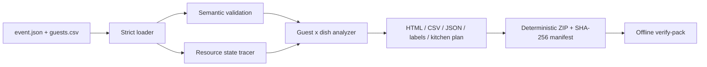

# AllergenGrid

**Guest CSV + menu JSON in. Candidate/hold/block matrix, cross-contact traces,
print cards, and a hash-verifiable event pack out. Offline. No AI guesses.**

[](https://github.com/KanadeK/allergengrid/actions/workflows/ci.yml)
[](https://github.com/KanadeK/allergengrid/releases)
[](https://www.python.org/)
[](LICENSE)

[简体中文](README.zh-CN.md) ·
[Input format](docs/input-format.md) ·
[Safety model](docs/safety-model.md) ·
[Repair guide](docs/troubleshooting.md)

Allergen information at a community supper, school event, volunteer kitchen, or
small catered gathering often lives in three disconnected places: a guest RSVP
sheet, recipe or package labels, and somebody's memory of which board or serving
spoon was reused. AllergenGrid joins those declarations without inventing facts.

It answers practical questions:

- Which dishes directly conflict with each guest's declared avoid list?
- Which cells must stay on hold because a label, recipe, diet tag, or ingredient
  has not been verified?
- Which allergen can travel from one dish to another through a board, pot, oil,
  appliance, or buffet utensil?
- Does a supplied `free_from` claim contradict ingredients or the declared
  preparation path?
- What should an organizer print, review, and archive before service?
- Can another person verify that the shared event pack is byte-for-byte intact?

> [!CAUTION]
> AllergenGrid is a documentation and review aid, not medical advice, staff
> training, a sanitation procedure, or a certification of food safety. A
> `CANDIDATE` result only means that no conflict was found in the declarations
> supplied to this run. Re-check current labels and recipes, resolve every hold,
> confirm preparation and service controls, and speak with each guest before
> serving food.

## What is real in v0.1.0

| Capability | What the tool actually does |
| --- | --- |
| Strict source loading | Reads UTF-8 `event.json` and `guests.csv`; rejects unknown allergens, malformed IDs, missing columns, and ambiguous aliases instead of guessing |
| Regulatory declaration profiles | Ships the US major 9, EU regulated 14, and a combined profile; custom explicit allergens are supported |
| Guest × dish analysis | Returns `BLOCK`, `HOLD`, or `CANDIDATE` with machine-readable reason paths |
| Preparation tracing | Carries declared `contains`, `may_contain`, and unknown ingredient state through reused resources until a valid cleaning boundary |
| Service tracing | Flags shared buffet utensils/containers as bidirectional cross-contact paths |
| Claim checking | Rejects direct `free_from` contradictions and invalidates claims affected by declared carry-over |
| Review outputs | Writes a self-contained HTML report, printable dish cards, CSV matrix, JSON analysis, Markdown kitchen handoff, receipt, and SHA-256 manifest |
| Portable evidence pack | Creates a deterministic ZIP containing exact inputs and reports; `verify-pack` checks every listed byte without extraction |
| Automation | Stable exit codes, JSON output, zero runtime dependencies, and CI-ready strict mode |

The tool deliberately does **not** infer allergens from ingredient names, scrape
recipes, diagnose allergies, or label a dish "safe."

## Five-minute run

### From source

```bash
git clone https://github.com/KanadeK/allergengrid.git
cd allergengrid
python -m venv .venv
```

Activate the environment:

```bash
# Linux / macOS
source .venv/bin/activate

# Windows PowerShell
.\.venv\Scripts\Activate.ps1
```

Install and audit the committed passing example:

```bash
python -m pip install -e .
allergengrid audit examples/community-supper-safe --strict
```

Build the full handoff:

```bash
allergengrid build examples/community-supper-safe --out build/community-supper --strict
allergengrid pack examples/community-supper-safe --out build/community-supper.zip --strict
allergengrid verify-pack build/community-supper.zip
```

Open `build/community-supper/report.html` locally and print
`build/community-supper/labels.html` for the service line.

### Single-file release

The GitHub Release includes a dependency-free Python zipapp:

```bash
python allergengrid-0.1.0.pyz audit community-supper-safe --strict
```

It requires Python 3.11 or newer but no installation.

## Status meanings

AllergenGrid uses action words instead of a dangerous yes/no "safe" claim.

| Status | Meaning | Required action |
| --- | --- | --- |
| `BLOCK` | A dish directly contains an allergen overlapping the guest's avoid list | Do not offer that dish for the declared constraint |
| `HOLD` | A `may_contain`, cross-contact path, missing diet tag, unverified ingredient, or unknown carry-over remains | Resolve the reason with current evidence and the guest; otherwise do not offer |
| `CANDIDATE` | No conflict was found in the supplied declarations | Re-check current labels, recipe, preparation, service setup, and guest needs before service |

Every status has a reason list. For one cell:

```bash
allergengrid explain examples/community-supper-safe \
  --guest leo \
  --dish yogurt-dip
```

Expected result:

```text
leo x yogurt-dip: BLOCK
  - DIRECT_CONTAINS: directly contains: milk
```

## Model a real event

Create a scaffold:

```bash
allergengrid init my-event --profile us
```

Each case is a directory:

```text
my-event/
├── event.json   # dishes, explicit ingredient declarations, resources, prep order
└── guests.csv   # guest constraints collected for this event
```

Minimal dish:

```json
{
  "id": "tomato-rice",
  "name": "Tomato rice",
  "ingredients": [
    {
      "name": "Rice",
      "contains": [],
      "may_contain": [],
      "verified": true,
      "evidence": "Current package label checked 2026-07-30"
    }
  ],
  "diet_tags": ["vegan"],
  "free_from": [],
  "prep_resources": ["pot-rice"],
  "service_resources": ["spoon-rice"]
}
```

Guest row:

```csv
guest_id,name,avoid_allergens,required_diets,notes
guest-1,Example guest,milk|sesame,vegan,Confirm on arrival
```

List values in CSV use `|`, not commas. AllergenGrid treats `notes` as human
context only; it never parses free text into a safety decision. See the full
[input contract](docs/input-format.md).

## Commands

```text
allergengrid init DIRECTORY [--profile us|eu|global]
allergengrid validate CASE [--json]
allergengrid audit CASE [--json] [--strict]
allergengrid explain CASE --guest ID --dish ID [--json]
allergengrid build CASE --out DIRECTORY [--strict]
allergengrid pack CASE --out FILE.zip [--strict]
allergengrid verify-pack FILE.zip [--json]
```

Exit codes are stable:

| Code | Meaning |
| ---: | --- |
| `0` | Command completed and the selected gate passed |
| `1` | Input, filesystem, or archive could not be read safely |
| `2` | Findings failed the selected gate, or package integrity failed |

Without `--strict`, warnings remain visible but only errors fail the command.
With `--strict`, either an error or warning returns `2`.

## The intentionally failing example

`examples/community-supper-risky` is not decorative sample data. It proves the
failure path:

- sesame noodles use a shared board;
- fruit is prepared next without a cleaning boundary;
- the fruit declaration is unverified;
- both dishes share buffet tongs;
- the fruit nevertheless carries a supplied `sesame` free-from claim.

Run:

```bash
allergengrid audit examples/community-supper-risky --strict
```

The command must return exit code `2` and include `AG203`, because the declared
resource path invalidates that claim.

## Verify the project

Install development tools once:

```bash
python -m pip install -e ".[dev]"
```

Run the normal gate:

```bash
python scripts/verify.py
```

Run the release gate:

```bash
python scripts/verify.py --release
```

The release gate requires all of the following:

- Ruff lint and format checks;
- strict mypy;
- unit, integration, CLI, tamper, and deterministic-package tests;
- at least 90% branch-aware coverage;
- safe and deliberately risky demo paths;
- secret and `Co-authored-by` trailer scan;
- wheel, source archive, single-file zipapp, example bundle, and checksums;
- two builds separated in time with byte-identical artifacts;
- clean-environment wheel install and strict example audit.

## When a command fails

Start with the exit code and the first finding:

```bash
allergengrid validate my-event
allergengrid audit my-event
allergengrid explain my-event --guest GUEST_ID --dish DISH_ID
```

Common repair sequence:

1. Fix malformed JSON/CSV or unknown identifiers until `validate` no longer
   returns `1`.
2. Record evidence for every ingredient marked `verified: true`.
3. Resolve direct `free_from` contradictions.
4. Add the actual preparation order and cleaning boundaries.
5. Replace or dedicate non-cleanable/shared resources.
6. Give every buffet dish a unique utensil or container.
7. Ensure every constrained guest has at least one candidate.
8. Re-run `audit --strict`, rebuild the outputs, and archive a new pack.

Every `AGxxx` code and package failure has a concrete fix in the
[troubleshooting guide](docs/troubleshooting.md).

## Why this project

The repository started with a dated gap study, not a UI mock. On 2026-07-30,
targeted GitHub repository searches for event allergen matrices, guest/dish
matching, and cross-contact graphs returned no directly comparable open-source
tool. Existing projects found in adjacent searches were general RSVP, recipe,
or AI meal-planning products; they did not join guest constraints to explicit
resource reuse with uncertainty-first output and a verifiable offline pack.

That search cannot prove universal non-existence, so the evidence and exact
queries are published in [docs/research.md](docs/research.md). The project is
designed for discoverability without pretending stars can be guaranteed:

- a broad, recurring problem outside software engineering;
- immediate value from committed sample data;
- no account, server, API key, or runtime package;
- useful HTML/print output for people and JSON/exit codes for automation;
- a memorable, searchable name and a one-command demo;
- transparent safety limits rather than an AI claim.

## Privacy and security

- All processing is local.
- The core has zero runtime dependencies and makes no network requests.
- Reports escape HTML, and CSV output neutralizes formula-shaped cells.
- Package verification enforces entry, size, path, and SHA-256 checks without
  extraction.
- Do not put real guest names or medical details in public issues or fixtures.
  Use synthetic data for bug reports.

Read [SECURITY.md](SECURITY.md) and [docs/safety-model.md](docs/safety-model.md)
before using the tool with sensitive event data.

## Architecture



The detailed data flow, determinism rules, and module boundaries are in
[docs/architecture.md](docs/architecture.md).

## Contributing

Start with [CONTRIBUTING.md](CONTRIBUTING.md). Safety-affecting changes need:

- a source or rationale;
- deterministic tests for both a passing and failing path;
- no ingredient-name inference presented as fact;
- documentation that keeps `CANDIDATE` distinct from "safe."

MIT licensed. AllergenGrid is independent and is not endorsed by the FDA, CDC,
European Commission, or any medical or regulatory body.
