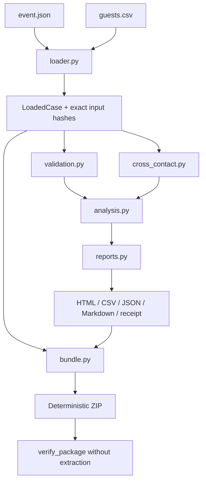

# Architecture

AllergenGrid is a zero-runtime-dependency Python 3.11+ application with one
analysis core shared by CLI, reports, tests, and release artifacts.

## Data flow



## Modules

| Module | Responsibility |
| --- | --- |
| `standards.py` | Standard allergen declaration sets, direct aliases, labels, and conservative category overlap |
| `models.py` | Immutable domain dataclasses and action enums |
| `loader.py` | Strict UTF-8 JSON/CSV parsing, normalization, and exact source hashing |
| `validation.py` | Semantic source-quality and resource-reference findings |
| `cross_contact.py` | Preparation resource state machine, shared-service graph, and review-only order draft |
| `analysis.py` | Guest/dish status classification and finding aggregation |
| `reports.py` | Escaped HTML, formula-neutralized CSV, JSON, Markdown, receipts, and manifests |
| `bundle.py` | Deterministic ZIP creation and bounded, no-extraction verification |
| `cli.py` | Stable commands, JSON mode, messages, and exit codes |

## Resource state machine

Each preparation resource carries zero or more exposure records:

```text
(allergen | unknown, source dish, contains | may_contain | unknown)
```

For each declared preparation step:

1. valid `clean_before` boundaries clear cleanable-resource state;
2. the target dish reads prior state from each resource;
3. prior declarations become reason paths for the target;
4. the target's direct, precautionary, and unknown declarations are appended to
   resource state.

A dedicated resource does not carry state from another dish. A non-cleanable
resource cannot be cleared with a cleaning declaration.

Service resources are modeled separately. A utensil/container used by multiple
dishes creates bidirectional exposure paths because buffet access does not have
a reliable linear order.

## Determinism

Given byte-identical `event.json` and `guests.csv`, the core:

- sorts findings and reasons by stable keys;
- emits JSON with sorted keys;
- emits CSV and text with explicit line endings;
- records exact source hashes and a combined input digest;
- writes ZIP entries in sorted order;
- sets ZIP metadata to 1980-01-01;
- uses fixed compression settings;
- uses `SOURCE_DATE_EPOCH` for Python packages;
- builds each wheel/sdist pair from an independent ASCII temporary source tree;
- rewrites the generated sdist with a fixed gzip header, member timestamp,
  owner, mode, and order because setuptools otherwise preserves local mtimes.

The release gate builds all artifacts twice with a delay and compares hashes.

No wall-clock generation time is written into reports or packages. Event dates
and revisions come from source data.

## Output integrity

Report `receipt.json` contains:

- tool version;
- event identity;
- input file hashes and combined digest;
- canonical analysis digest;
- output hashes;
- status and finding counts.

`manifest.sha256` hashes report files. The portable ZIP adds
`package-manifest.json`, which lists every input and report entry with size and
SHA-256.

Verification:

- never extracts files;
- rejects unsafe paths and duplicate names;
- limits entry count and total uncompressed size;
- rejects missing or unlisted entries;
- checks size and hash for every declared entry.

## Security decisions

- No network or plugin architecture in the core.
- No template engine; all HTML values use `html.escape`.
- CSV cells beginning with formula-control characters are prefixed with `'`.
- IDs are bounded portable strings.
- Archive paths are fixed by the application.
- Unknown data blocks confidence instead of silently downgrading risk.

## Extension seams

Future importers should produce the existing `LoadedCase` contract or write the
same source files. They must not bypass validation. New output formats should
consume `AnalysisResult`, so they cannot reimplement status logic independently.
